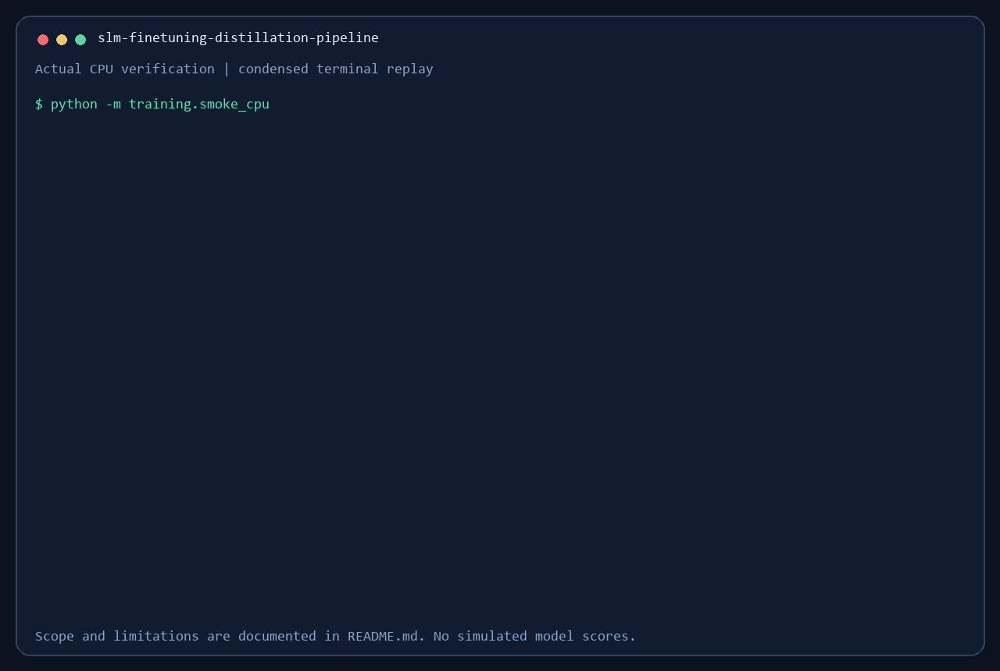

# Text-to-SQL Fine-Tuning Pipeline

Train, serve and evaluate language-model adapters for natural-language SQL generation.

The pipeline connects dataset validation, completion-only LoRA training, local model inference and execution-based evaluation. A Colab workflow configures Qwen3-8B with NF4 QLoRA and preserves training checkpoints in Google Drive.

## Pipeline

~~~mermaid
flowchart LR
  Data[Questions, schemas and SQL] --> Split[Train, validation and evaluation splits]
  Split --> Train[Completion-only LoRA or QLoRA]
  Train --> Adapter[Adapter and checkpoints]
  Adapter --> Inference[Local model inference]
  Inference --> Predictions[Generated SQL]
  Predictions --> Validation[AST and schema checks]
  Validation --> Evaluation[Read-only execution matching]
~~~

## Features

- **Dataset preparation:** seeded splits, schema validation and provenance manifests.
- **Training:** completion-only supervision with LoRA and CUDA NF4 QLoRA.
- **Recovery:** periodic full checkpoints, progress logs and guarded resume.
- **Inference:** local Hugging Face models with optional PEFT adapters.
- **SQL validation:** read-only statement policies and schema-aware checks.
- **Evaluation:** independent predictions, execution matching, error reports and confidence intervals.
- **Export:** adapter merging and a configurable llama.cpp GGUF conversion path.

## Completed experiment

A 100-step Qwen3-8B NF4 QLoRA run on a Tesla T4 used 1,000 training questions and evaluated 100 questions across 18 held-out databases.

| Model | Execution matches |
|---|---:|
| Base | 70 / 100 |
| Adapter | 71 / 100 |

The report includes paired outcomes, uncertainty estimates, column-order sensitivity and generated-database checks. It describes a bounded adaptation experiment on a filtered public Spider development subset.

[Experiment report and reproduction](docs/EXPERIMENT.md) ? [Frozen predictions and metadata](experiments/results/t4-qlora-001/README.md)

Replay the saved experiment on CPU:

~~~sh
pip install -r requirements-reproduce.txt
python -m experiments.reproduce --download-fixtures --output-dir artifacts/replay
~~~

This downloads the pinned SQLite fixtures and requires no model weights or GPU. An offline replay can use --archive /path/to/sql-8b-results.zip instead.

## Start with the GPU notebook

[Open the training notebook](experiments/colab_8b_qlora.ipynb)

Each Markdown block explains the cell below it and its expected output. The notebook:

1. Loads source and checks the CUDA runtime.
2. Downloads a pinned Qwen3-8B snapshot.
3. Prepares database-disjoint Spider splits.
4. Evaluates the base model.
5. Trains an adapter with visible progress and checkpoints.
6. Evaluates the adapter on the same held-out questions.
7. Packages the predictions, scores, model provenance and adapter.

The training cell mounts Google Drive and saves full checkpoints every 10 optimizer steps under MyDrive/ai-project-experiments/sql-8b-run-001/adapter. Complete checkpoints can restore model, optimizer and scheduler state with matching data and configuration.

See [experiment setup](experiments/README.md) for the source archive and run instructions. Model-quality scores are produced by the completed evaluation run.

## Local setup and dataset checks

~~~sh
python -m venv .venv
# Activate the environment, then:
pip install -r requirements.txt
python main.py --generate
python main.py --validate data/train.jsonl
python main.py --validate data/validation.jsonl
python main.py --validate data/test.jsonl
python -m pytest -q
~~~

The included 50-example dataset supports local development with a single schema. The GPU experiment uses populated Spider databases and separates database IDs across training, validation and evaluation.

## CPU training walkthrough

~~~sh
pip install -r requirements-ml.txt
python -m training.smoke_cpu
~~~

This builds a tiny local Llama model and tokenizer, performs two LoRA optimization steps, saves and reloads the adapter, and generates output. It provides a quick check of the training and inference path without downloading pretrained weights.

## Train from the CLI

With CUDA, bitsandbytes and a downloaded model:

~~~sh
python -m training.train --model_id /models/base --train_file data/train.jsonl --val_file data/validation.jsonl --output_dir artifacts/adapter --batch_size 1 --gradient_accumulation_steps 8 --max_steps 100 --save_steps 10 --resume_from_checkpoint auto
~~~

Training records step/loss progress, configuration fingerprints and complete checkpoints. Changed training inputs require a new output directory. Use --allow_cpu with a suitably small model for full-precision CPU LoRA.

## Serve an adapter

Set MODEL_PATH to the local base-model directory and ADAPTER_PATH to the trained adapter, then:

~~~sh
uvicorn serving.app:app --host 127.0.0.1 --port 8000
~~~

| Endpoint | Purpose |
|---|---|
| /health | Report model readiness |
| /predict/sql | Generate and validate SQL |
| /v1/chat/completions | Chat-compatible SQL generation with optional buffered SSE |

The server supplies the schema context. SQL generation and validation are separate from database execution.

## Evaluate predictions

~~~sh
python -m evals.predict --model /models/base --adapter artifacts/adapter --test_file data/test.jsonl --output artifacts/predictions.jsonl
python -m evals.benchmark --test_file data/test.jsonl --predictions artifacts/predictions.jsonl --output_dir artifacts/evaluation
~~~

Prediction records are matched to evaluation questions by ID. Queries execute against read-only SQLite fixtures with deadlines. Ordered results use sequence comparison; other results use row-multiset comparison.

The Spider experiment reports execution matching on a public development subset, including confidence intervals and nonempty-reference results. This metric differs from official Spider test-suite accuracy. Choose evaluation fixtures that support the SQL dialect in your dataset.

## Export

~~~sh
python -m export.quantize --base_model_id artifacts/cpu_smoke/base --lora_path artifacts/cpu_smoke/adapter --output_dir artifacts/exported --format merged
~~~

GGUF conversion additionally requires --format gguf and --llama_cpp_dir pointing to a converter and built quantizer.

## Validation

The CPU suite passes 28 tests. Local checks cover training/save/reload, adapter merging, interrupted training recovery and evaluation edge cases. A fresh CPU environment with only SQLGlot installed reproduced the saved experiment and repeated diagnostics.

[CI results](https://github.com/adexxhh/slm-finetuning-distillation-pipeline/actions/runs/39961314334) ? [CPU training evidence](docs/evidence/cpu-smoke.json) ? [Resume evidence](docs/evidence/resume-verification.json)

## Demo

[PNG](assets/demo.png) ? [Command transcript](assets/demo-transcript.json)

Regenerate the walkthrough with requirements-demo.txt and python scripts/render_demo.py.

## Development

[Engineering guide](OWNERSHIP.md) ? [Continuation notes](HANDOFF.md)

With the three project repositories cloned into sibling directories, rebuild the notebook source archives using:

~~~sh
python scripts/build_source_bundles.py --output-dir ../
~~~
